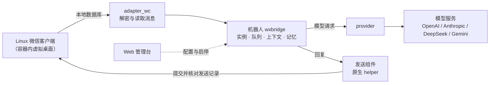

# wxbridge

wxbridge 是运行在 Linux 微信上的 AI 机器人，支持群聊、私聊、图片理解与生成、引用改图、长期记忆和 Web 管理。

一个微信账号对应一个容器，内部可创建多个独立会话实例。Docker 固定程序和依赖版本，账号登录、配置及长期数据保存在外部目录，方便在其他主机部署和升级。默认直连模型服务，不要求代理或 CPA。Docker 是唯一支持的部署方式。

- [概览](#概览)：工作原理、容器内的组件、功能、部署流程一览
- [部署](#部署)：从零启动到机器人开始回复
- [日常使用](#日常使用)：常用操作、排查问题、图片功能、多个账号
- [文件位置](#文件位置)：部署目录、容器内路径、运行时文件、源码仓库
- [更新](#更新)：更新机器人、分发镜像、备份与迁移、更新微信适配库
- [本地开发](#本地开发) · [配置与参考资料](#配置与参考资料)

## 概览

### 工作原理



一条消息的处理过程：

1. 微信客户端在容器的虚拟桌面里运行，收到的消息写入它的本地数据库。
2. 机器人通过 `adapter_wc` 读取解密后的数据库，找到属于某个会话实例的新消息，判断是否需要回复（群聊由参与模型决定）。
3. 机器人组装上下文、记忆和图片，经 `provider` 调用该实例配置的模型。
4. 回复交给发送组件提交到微信，机器人再从数据库核对这条消息确实已发出，然后才视为完成。

### 容器内的组件

`account` 容器里由一个主控进程管理以下组件。名称与管理台“服务管理”“运行日志”中显示的一致：

| 组件 | 作用 | 日志文件 |
| --- | --- | --- |
| 主控 | 以 root 运行，启动、监控和重启下面各组件，执行管理台发来的启停请求 | `supervisor.log` |
| 微信会话 | 虚拟桌面与 Linux 微信客户端，负责扫码登录和保持在线 | `session-supervisor.log` |
| 发送组件 | 原生 helper，只向已授权的会话提交文本和图片 | `sender.log` |
| 机器人 | 读取消息、调度实例队列、调用模型、写入记忆，核对发送结果 | `bot-live.log`（事件摘要另见 `bot.log`） |
| 管理台 | Web 管理界面，默认监听 `127.0.0.1:8730` | `web.log` |
| 自动恢复 | 扫描数据库密钥并准备解密库，供机器人读取 | `recovery.log` |

微信会话、机器人和管理台以非特权用户 `wxbridge`（uid 10001）运行；主控、发送组件和自动恢复需要 root 权限。日志文件的位置见[运行时文件](#运行时文件)。

### 功能

- **多会话实例**：群聊、私聊各自配置模型、提示词、启停状态和记忆；实例可独立应用配置。
- **模型接入**：支持 OpenAI、Anthropic、DeepSeek、Gemini 的现有协议适配，以及相应兼容网关；代理按需配置。
- **AI 能力**：自动回复、群聊参与判断、上下文管理、长期记忆和关系学习，具体取决于模型与实例设置；可选口语化的“像朋友一样聊天”风格，按段分条发送。
- **图片能力**：理解引用图片，可选自动附带会话窗口中的图片；支持 OpenAI Images 和 Gemini 文生图，以及引用原图后的修改，详见[图片理解与引用改图](#图片理解与引用改图)。
- **微信接入**：通过 [`adapter_wc`](#源码仓库) 读取数据库、会话、消息和媒体，经原生 helper 提交文本、图片并协调发送确认。兼容档案针对微信 `4.1.13.26 x86_64`。
- **运行管理**：集成虚拟桌面、扫码登录、恢复和有序停机；Compose 停机宽限期为 10 分钟。未扫码不会仅因未登录而反复重启。
- **数据隔离**：配置、登录和长期记忆持久化；队列使用私有 tmpfs；解密库及扫描出的数据库密钥使用 `tmpfs,noswap`，验证失败拒绝启动。开发阶段默认例外：提示词与模型回复会保存到 `data/home/trace`，见[对话追踪](#对话追踪开发调试)。
- **网络**：账号容器采用 host 网络，仍保留私有 PID、IPC 和文件系统。管理台默认只监听 `127.0.0.1`；从旧版迁移时会将原来的 `0.0.0.0` 改为 loopback。
- **管理台与 CLI**：Web 管理台带认证及 Host/Origin 检查，可查看各组件的运行日志与错误，以及每次模型任务收到的提示词和返回的回复；容器内可通过 `docker compose exec account wxbridge status` 等命令运维；整个容器的启停与日志使用 `docker compose`。

### 部署流程一览

| 步骤 | 做什么 | 在哪里 |
| --- | --- | --- |
| [0. 准备](#0-准备代码和微信安装包) | 获取代码，下载并校验微信安装包 | Linux 主机 |
| [1. 启动](#1-启动) | 构建镜像并启动容器，自动生成 `data/`、`provider.env` 和管理台密码 | Linux 主机 |
| [2. 填写密钥](#2-填写模型密钥) | 在 `provider.env` 填写所用模型服务的密钥 | Linux 主机 |
| [3. 登录与配置](#3-打开管理台并登录微信) | 扫码登录微信，创建会话实例，绑定账号，启动机器人 | 管理台 |

之后的修改、排查和更新见[日常使用](#日常使用)与[更新](#更新)。

## 部署

需要 **Linux amd64、Docker Engine 23+（默认启用 BuildKit）和 Compose 插件**，内核须支持 `tmpfs,noswap`（已在 Debian 13 / Linux 6.12 验收）。宿主机无需安装 Python、Node 或微信。Windows 和 macOS 不能运行机器人，只能用于[本地开发](#本地开发)。

### 0. 准备代码和微信安装包

还没有仓库时克隆：

```bash
git clone https://github.com/yz68ac/message_bot.git
cd message_bot
```

已有本地仓库时无需重新克隆，切到 `main` 并同步：

```bash
cd message_bot
git status                 # 确认没有未提交的修改
git checkout main
git pull --ff-only
```

微信安装包不进入 Git（已被 `.gitignore` 排除，克隆后 `installer/` 目录也不存在），每台构建主机都需单独下载，并用仓库内的校验和核对。固定版本的安装包附在 [GitHub Release `wechat-4.1.13.26`](https://github.com/yz68ac/message_bot/releases/tag/wechat-4.1.13.26)：

```bash
cd resources/wechat/linux-x86_64/4.1.13.26
curl -fL --create-dirs -o installer/WeChatLinux_x86_64.deb \
  https://github.com/yz68ac/message_bot/releases/download/wechat-4.1.13.26/WeChatLinux_x86_64.deb
sha256sum -c --ignore-missing SHA256SUMS
cd -
```

腾讯官方地址 `https://dldir1v6.qq.com/weixin/Universal/Linux/WeChatLinux_x86_64.deb` 始终指向最新版，只有在腾讯尚未更新时才能得到同一文件；校验失败说明版本已变化，应改用上面的 Release 备份。微信为腾讯公司的专有软件，本项目与腾讯无关联，使用须遵守微信软件许可及服务协议。

若本地仓库在 Windows 上，需把仓库复制到 Linux 主机（或在主机上克隆），并一并复制 `resources/wechat/linux-x86_64/4.1.13.26/installer/WeChatLinux_x86_64.deb`（保持该相对路径，Docker 构建从这里挂载安装包）。不要复制 `.venv/`、`node_modules/`、`provider.env`、`data/` 等本机文件；迁移已有账号时才复制后两者，见[备份与迁移](#备份与迁移)。

### 1. 启动

在仓库根目录执行：

```bash
WXBRIDGE_COMMIT=$(git rev-parse HEAD) docker compose up -d --build
```

`WXBRIDGE_COMMIT` 把当前提交写入镜像，供状态和日志显示运行版本；构建上下文不含 `.git`，省略时机器人照常运行，但版本显示为 `unknown`。若工作区有未提交的修改，镜像仍会标记为 HEAD 的提交；正式部署请从已提交的代码构建，或使用[分发镜像](#分发镜像)（自动写入提交）。

首次构建需要联网，并需要第 0 步放置的微信安装包。镜像会校验安装资源、固定的 `adapter_wc` wheel 及其原生资源，并构建依赖。构建按变动频率分层：微信客户端、Python 依赖和前端依赖只在安装包、锁文件或前端变化时重建，日常只改源码的更新只重做最后几步；下载缓存保留在 BuildKit 缓存中，微信安装包只在构建时挂载、不写入镜像。其他同架构主机可直接使用构建好的镜像，无需微信安装包和构建工具，见[分发镜像](#分发镜像)。当前尚未提供公开镜像。

Compose 自动创建 `data/` 和 `provider.env`，设置初始目录权限并生成管理台密码（各文件的作用见[部署目录](#部署目录宿主机)）。短暂运行的 `init` 服务完成后退出，长期运行的是 `account` 容器。若 Docker 要求管理员权限，在命令前加 `sudo`。

### 2. 填写模型密钥

编辑 `provider.env`，只需填写所用服务的密钥，例如：

```bash
sudoedit provider.env
```

```dotenv
DEEPSEEK_API_KEY=你的密钥
```

| 变量 | 用途 |
| --- | --- |
| `OPENAI_API_KEY` / `ANTHROPIC_API_KEY` / `DEEPSEEK_API_KEY` / `GEMINI_API_KEY` | 各 Provider 的密钥 |
| `<PROVIDER>_BASE_URL` | 可选，网关地址，如 `OPENAI_BASE_URL`；Gemini 地址不包含 `/v1` 或 `/v1beta` |
| `<PROVIDER>_PROXY_URL` | 可选，仅需要代理的 Provider 填写，如 `OPENAI_PROXY_URL`；未配置则直连 |
| `GEMINI_IMAGE_BASE_URL` | 可选，Gemini 生图默认复用 `GEMINI_BASE_URL`，仅需独立地址时填写 |
| `DEEPSEEK_SEARCH_API_KEY` | 仅在实例的 `search.api_key_env` 指向该变量时使用 |

完整模板见 [`.env.example`](.env.example)。默认使用 host 网络，与 Linux 宿主机共享网络；宿主机代理可直接填写 `http://127.0.0.1:10808`，本机 CPA 可填写 `http://127.0.0.1:8317`。无需 `extra_hosts`、端口映射或额外代理转发。

部署根目录只读挂载以读取 `provider.env`，支持原子替换；密钥不写入镜像。容器可读取部署目录中其他具有读取权限的文件，请勿在该目录混放无关私密文件。普通编辑可保留原权限；原子替换时需保留 `root:10001`、`0440` 的文件读取权限。

### 3. 打开管理台并登录微信

访问 **http://127.0.0.1:8730**，初始管理密码在 `data/settings/web-password`：

```bash
sudo cat data/settings/web-password
```

远程服务器默认仅允许本机访问，可在自己的电脑建立 SSH 隧道后打开同一地址：

```bash
ssh -L 8730:127.0.0.1:8730 用户名@服务器地址
```

工作台顶部的“开始使用”卡片按顺序列出四步，并高亮下一步：

1. **模型密钥**：确认 `provider.env` 已填写（第 2 步），点击“我已填写，重新检测”。
2. **微信登录**：点击“打开登录二维码”，扫码并在手机上确认；随后点击“连接账号”，之后即可按名称搜索联系人和群聊。
3. **会话实例**：点击“创建会话实例”，选择群聊或联系人、选择回复模型并启用。可先用“文件传输助手”测试；群聊还需配置参与模型。
4. **授权并启动**：点击“授权并启动机器人”，为全部实例会话授权发送并启动机器人。进度显示在卡片和“服务管理 → 操作记录”中。

四步完成后卡片收起为一行状态。之后新增会话时，工作台和“会话实例”页会提示“尚未授权发送”，点击“授权并重启机器人”即可：机器人会等待进行中的发送完成后短暂停止，授权后自动重新启动。

想让回复更像真人聊天，在实例配置的“回复风格”中打开“像朋友一样聊天”，并在“系统提示词”中设定人设（可从“使用模板”开始）。

## 日常使用

### 常用操作

| 操作 | 方式 |
| --- | --- |
| 修改实例、提示词 | 管理台保存并应用，无需重启容器 |
| 修改模型密钥、网关或代理 | 修改 `provider.env`，在服务管理应用机器人配置 |
| 查看状态、启停机器人 | 管理台“服务管理”，或 `docker compose exec account wxbridge status` |
| 排查错误 | 管理台“运行日志”和工作台“最近问题”，见[排查问题](#排查问题) |
| 查看某次回复发给模型的提示词、模型原始回复 | 管理台“对话追踪”，见[对话追踪](#对话追踪开发调试) |
| 查看容器日志 | `docker compose logs --tail 100 -f account` |
| 停止整套环境 | `docker compose stop` |
| 重启整套环境 | `docker compose restart account` |

完整重启或重建容器会清空队列、游标和未完成任务，以最新消息重新建立基线，不补回复旧消息。仅应用配置或重启内部机器人会保留内存队列和游标。微信登录与长期数据保留，微信要求手机确认时按提示操作。哪些文件会保留、哪些会清空，见[文件位置](#文件位置)。

### 排查问题

出现异常时按以下顺序查看：

1. **管理台工作台的“最近问题”**：汇总最近 24 小时各组件的警告与错误，点击可跳到对应日志。
2. **管理台“运行日志”**：按组件和级别筛选、搜索文本，展开错误的堆栈；同一错误连续重复时合并显示次数。带任务编号的行可点“查看追踪”，直接看那次发给模型的提示词和模型的回复。
3. **管理台“对话追踪”**：回复不对劲时，查看模型实际收到的内容和原始回复，见[对话追踪](#对话追踪开发调试)。
4. **容器内 CLI**：管理台打不开时使用，例如：

   ```bash
   docker compose exec account wxbridge status
   docker compose exec account wxbridge logs --component bot --lines 200 -f   # 可选 bot、wechat、web、sender
   ```

5. **`docker compose logs account`**：包含所有组件的输出，容器无法启动时也能查看。

运行日志读取主控为各组件保存的输出（见[容器内的组件](#容器内的组件)），每个文件只读最近 512 KB。警告、错误和堆栈完整显示，普通信息只保留事件名和状态码；密钥、令牌和长串会自动隐藏，但错误信息中仍可能出现聊天片段，管理台口令请妥善保管。这些日志位于容器的临时目录，重启容器后清空；机器人的警告和堆栈另有一份持久副本（“运行日志”的“历史问题”），见下节。

### 对话追踪（开发调试）

开发阶段，回复不对劲时需要看到模型实际收到了什么。每个实例默认开启“保存提示词与模型回复”（实例设置 `trace.enabled`，在管理台“业务参数”的“调试追踪”中开关），机器人每完成一次模型任务就保存一条记录，管理台“对话追踪”页可以查看：

- **发给模型的完整提示词**：系统提示词（含自动追加的输出规则）、聊天上下文（本轮新消息高亮，历史和记忆可展开）、每一轮的工具调用与搜索结果；
- **模型的原始回复**、结束原因、用量和耗时；回复、接话判断、记忆整理和群资料分析都有记录，同一任务的重试按“第几次”分开；
- **出错时**的错误码、堆栈，以及服务商返回的错误说明（已隐藏密钥和地址中的账号口令）；
- **之后发生的事**：实际排队发送的内容、失败后改发的兜底回复、被废弃的生成，以及接话判断的结果。

从“运行日志”和工作台“最近问题”中带任务编号的行可点“查看追踪”。“运行日志”的“历史问题”保存机器人的警告和堆栈，容器重启后仍在，不计入工作台的“最近问题”。

记录保存在容器内 `/var/lib/wxbridge/trace`（宿主机 `data/home/trace/`，目录权限 0700），重启容器后保留。默认最多保留 14 天、占用 300 MB，超出后从最早的记录开始删除；两项都可在“调试追踪”中调整（实例设置 `trace.keep_days`、`trace.max_megabytes`）。同一账号的实例共用一个数据库，按各实例中最大的值执行。“历史问题”另占最多约 4 MB。

> **隐私**：记录按原样保存提示词，其中包含聊天原文（含群里其他成员的发言）和长期记忆，只有管理台登录口令保护。这是开发阶段的取舍。正式使用前请在每个实例关闭“保存提示词与模型回复”，并删除 `data/home/trace/`；关闭后不再写入新记录。备份时也可排除这个目录。

### 图片理解与引用改图

图片理解使用实例的回复模型，该模型需支持图片输入。在管理台实例配置中打开“自动将图片加入上下文”，或在实例 JSON 中设置以下字段，再保存并应用：

```json
{
  "vision": {
    "enabled": true,
    "context_images_enabled": true,
    "max_images": 4
  }
}
```

`vision.enabled` 默认开启，`vision.context_images_enabled` 默认关闭。关闭自动上下文时，仍可通过微信“引用”图片发问；开启后，会从当前会话保留的上下文中附带图片，不扩大历史读取范围。引用图片优先，其余按最近图片补充，共用每次最多 4 张、每张最多 8 MiB 的限制；读不到图片时会标明不可用。

生图和改图还需开启 `image_generation.enabled`，选择 `model_clients.image` 并填写 `models.image.model`。回复模型需支持工具调用，改图时还需能读取引用图片。图片连接可选 `openai` 或 `gemini`，配置见[实例示例](examples/instance/config.example.jsonc)和[模型服务配置](#2-填写模型密钥)。

修改图片时，在微信中引用要修改的那张图片，再描述要求，例如“把背景改成雪山”。每轮最多一个图片任务；只有本轮实际读到的引用图片可作为改图来源，普通历史图片不会自动作为改图原图。原图不可用时需重新引用；编辑接口失败也不会自动切换成文生图。

机器人生成的图片在确认发出后会按上下文窗口有限保留，供后续识图或引用修改；这不是长期图片记忆，重建账号容器会清空临时索引。图片输入的用量不包含在 `target.context_max_chars` 文本字符预算中，同一图片在后续请求中再次附带也会产生输入用量，实际以模型服务返回的 usage 为准。

### 多个账号

同一份账号数据只能由一个运行环境使用。第二个账号应使用独立部署目录、Compose 项目名和端口；可用 `WXBRIDGE_WEB_PORT` 设置各账号管理台的实际监听端口，例如 `WXBRIDGE_WEB_PORT=8731 docker compose -p account2 up -d`（启动时覆盖已保存的端口）；`WXBRIDGE_IMAGE` 指定镜像。多个账号共享主机网络，需选择不同端口。

## 文件位置

### 部署目录（宿主机）

部署目录就是克隆下来的仓库根目录。运行后新增的只有 `provider.env` 和 `data/`，两者都不进入 Git：

```text
message_bot/
├── compose.yaml          容器定义：挂载、tmpfs、资源限制
├── Dockerfile            镜像构建
├── provider.env          模型密钥、网关与代理（首次启动时创建，需自行填写）
├── resources/wechat/…/installer/WeChatLinux_x86_64.deb   微信安装包（仅构建时需要）
└── data/                 账号的全部持久数据（首次启动时创建）
    ├── config/           账号与实例配置
    │   ├── config.json                     账号配置：数据库目录、队列、发送授权等
    │   └── instance/<实例ID>/
    │       ├── config.json                 实例配置：会话、模型、记忆、图片等
    │       ├── system.md                   系统提示词
    │       └── .web-history/               管理台保存的提示词历史
    ├── home/             wxbridge 用户的主目录
    │   ├── （微信客户端数据）               登录状态和原始数据库 db_storage
    │   ├── memory/                         长期记忆
    │   └── trace/                          调试追踪：提示词、模型回复、历史问题（可删除）
    ├── settings/         管理台与发送组件的设置
    │   ├── web-password                    管理台密码
    │   ├── web.json                        管理台监听地址和端口
    │   ├── helper-config.json              发送组件的会话授权清单
    │   └── boot.json                       启动时使用的数据库目录
    ├── service/
    │   └── state.json                      机器人、管理台是否处于启用状态
    └── catalog/
        └── models.json                     模型目录缓存
```

### 容器内路径对照

| 宿主机 | 容器内 | 内容 | 重启或重建容器后 |
| --- | --- | --- | --- |
| `data/config/` | `/var/lib/wxbridge-config` | 账号与实例配置 | 保留 |
| `data/home/` | `/var/lib/wxbridge` | 微信登录、原始数据库、长期记忆、调试追踪 | 保留 |
| `data/settings/` | `/etc/wxbridge` | 管理台密码与设置、发送授权 | 保留 |
| `data/service/` | `/var/lib/wxbridge-service` | 启停状态 | 保留 |
| `data/catalog/` | `/var/lib/wxbridge-web` | 模型目录缓存 | 保留 |
| 部署目录（只读） | `/run/secrets/wxbridge` | 读取其中的 `provider.env` | 保留 |
| — | `/run/wxbridge-trial` | 运行时文件：日志、队列、游标、状态，见下节 | 清空 |
| — | `/run/wxbridge-sensitive` | 数据库密钥 `keys.json` 与解密库 `decrypted/`，内存盘且不进入 swap | 清空 |
| — | `/run/wxbridge-control` | 主控的控制套接字 | 清空 |
| 镜像内 | `/opt/wxbridge`、`/opt/wechat`、`/opt/wxbridge-native-helper` | 程序与 Python 环境、微信客户端、原生 helper | 随镜像更新 |

管理台和 CLI 中显示的都是容器内路径。在容器内执行 `wxbridge config` 可列出当前使用的配置文件位置。

### 运行时文件

`/run/wxbridge-trial` 是容器内 512 MB 的内存盘，只在容器运行期间存在：

| 文件 | 内容 |
| --- | --- |
| `supervisor.log`、`bot-live.log`、`session-supervisor.log`、`sender.log`、`web.log`、`recovery.log` | 各组件输出，对应[容器内的组件](#容器内的组件)，管理台“运行日志”读取的就是这些文件 |
| `bot.log` | 机器人的事件摘要，工作台“最近运行事件”读取此文件 |
| `queue.sqlite3` | 待处理的消息和任务队列 |
| `state.json` | 消息读取游标等运行状态 |
| `account-status.json`、`login-status.json` | 机器人心跳与微信登录状态，供管理台显示 |
| `native-helper.sock` | 机器人与发送组件之间的套接字 |

需要长期保留的排查信息，请在重启前从管理台复制，或用 `docker compose logs account` 导出。开启调试追踪时，提示词、模型回复和机器人的警告另存于 `data/home/trace/`，不受重启影响，见[对话追踪](#对话追踪开发调试)。

### 源码仓库

系统由两个独立的 Git 仓库组成：本仓库 [`message_bot`](https://github.com/yz68ac/message_bot) 和微信适配库 [`adapter_wc`](https://github.com/yz68ac/adapter_wc)。需要同时开发两者时，建议放在同一父目录下：

```text
bot/
├── message_bot/   本仓库：机器人（wxbridge）、Web 管理台、模型调用库（src/provider）
└── adapter_wc/    微信适配库 adapter_wc：数据库、消息、媒体、登录与原生提交
```

本仓库的主要目录：

```text
message_bot/
├── src/
│   ├── wxbridge/         机器人：实例、队列、上下文、记忆、发送确认（代码地图见其 README）
│   │   └── host/         容器初始化、主控与各组件的启动
│   ├── wxbridge_cli/     容器内命令 wxbridge
│   ├── web/backend/      管理台后端（FastAPI）
│   ├── web/frontend/     管理台前端（Vue）
│   └── provider/         模型协议与 SDK 调用
├── prompts/              默认提示词与表情、话题数据
├── examples/             账号与实例配置示例
├── config.defaults.json  配置默认值（由 scripts/config-defaults.py 生成）
├── dependencies/         固定版本的 adapter_wc wheel 及其校验记录
├── resources/wechat/     微信安装包的版本清单与校验和
├── scripts/              构建、测试、镜像分发与适配库更新脚本
└── tests/                离线测试
```

| 组件 | 位置 | 职责 |
| --- | --- | --- |
| wxbridge | `src/wxbridge`、`src/wxbridge_cli` | 实例、授权、Journal、发送确认、记忆和学习；CLI 入口 `wxbridge` |
| Web 管理台 | `src/web` | FastAPI 后端与 Vue 前端 |
| model-provider | `src/provider` | 模型协议和 SDK 调用，导入名 `provider`，见 [provider 说明](src/provider/README.md) |
| adapter_wc | `../adapter_wc`，以固定 wheel 形式放在 `dependencies/` | 微信数据库、消息、媒体与原生提交，接口见适配库仓库的 `docs/API.md` |

机器人**不**直接使用 `../adapter_wc` 的工作区源码，而是依赖 `dependencies/adapter_wc-<版本>-py3-none-any.whl`；`dependencies/adapter_wc.json` 记录该 wheel 的版本、SHA-256、源码提交和标签。Docker 构建、离线测试和发布都只读取这个固定产物，因此**部署和日常开发不需要 `adapter_wc` 仓库**，只有修改适配库时才需要（见[更新微信适配库](#更新微信适配库)）。

## 更新

### 更新机器人

```bash
cd message_bot
git pull --ff-only
WXBRIDGE_COMMIT=$(git rev-parse HEAD) docker compose up -d --build
```

使用预先构建的镜像时，按[分发镜像](#分发镜像)导入新镜像，切换到对应提交后执行 `docker compose up -d --no-build`。重建容器会清空队列和游标并以最新消息重新建立基线（见[常用操作](#常用操作)），建议在空闲时更新；账号登录、配置和长期数据保留在 `data/` 中。

### 分发镜像

在一台构建主机上从干净的已提交代码构建一次，再分发到其他主机：

```bash
python3 scripts/container-image.py export ../images        # 构建并保存 wxbridge:<提交> 与对应的 .json 说明
scp ../images/wxbridge-image-<提交>.* 用户名@目标主机:/var/tmp/
```

在目标主机上（需要本仓库的同一提交，用于 `compose.yaml`，但不需要微信安装包、Node 或构建工具）：

```bash
git checkout <提交>
python3 scripts/container-image.py load /var/tmp/wxbridge-image-<提交>.json   # 校验 SHA-256 后 docker load 并标记为 wxbridge:local
docker compose up -d --no-build
```

改用镜像仓库时，可在构建主机上自行执行 `docker tag wxbridge:<提交> <仓库地址>/wxbridge:<提交>` 和 `docker push`，目标主机拉取后以 `WXBRIDGE_IMAGE=<仓库地址>/wxbridge:<提交> docker compose up -d --no-build` 启动。镜像内含微信客户端，请只推送到私有仓库。

### 备份与迁移

备份或迁移时保留根目录的 `provider.env` 和整个 `data/` 目录及权限，各子目录的内容见[部署目录](#部署目录宿主机)。容器内的运行时文件和解密库不需要备份，启动时会重新生成。`data/home/trace/` 含聊天原文，只是排查用的记录，备份时可以排除。

迁移到新主机时，先在新主机完成[准备代码](#0-准备代码和微信安装包)，复制上述文件后再执行[启动](#1-启动)中的构建命令。不要让两个运行环境同时使用同一份数据。

### 更新微信适配库

只有修改 `adapter_wc` 本身时才需要此流程。机器人只接受**从干净、带版本标签的提交构建**的 wheel，并拒绝同一版本号对应不同内容。

1. 在 `../adapter_wc` 中完成修改、测试并提交，使工作区干净（无需手动改版本号）。

2. 在本仓库用一条命令发布并导入新版本：

   ```bash
   cd ../message_bot
   python scripts/update-wechat-adapter.py --release <新版本号> --source-repo ../adapter_wc
   ```

   它依次执行适配库的 `scripts/release.py`（更新所有版本号、重新锁定、离线测试、创建 `release: adapter_wc <版本号>` 提交和 `v<版本号>` 标签、构建 wheel 并做隔离导入检查），再核对 wheel 内容与标签源码一致，更新 `pyproject.toml` 的版本固定和 `dependencies/adapter_wc.json`、删除旧版本 wheel，最后执行 `scripts/dependencies.py`、`uv sync` 和本仓库的离线测试。任何一步失败都会停止；适配库在提交前失败时会撤销版本号改动。

   已有从干净标签构建的 wheel 时，也可只导入：`python scripts/update-wechat-adapter.py ../adapter_wc/dist/adapter_wc-<版本号>-py3-none-any.whl --source-repo ../adapter_wc`，再按提示执行 `scripts/dependencies.py` 和 `uv sync`。

   检查 `pyproject.toml`、`uv.lock`、依赖清单与 wheel 的变更后再提交本仓库，然后按[更新机器人](#更新机器人)重新部署。

3. 镜像构建需要复制或核对的适配库文件（helper 与图片资源、profile、密钥恢复模块）及图片 helper 运行目录，统一由适配库包内的 `deployment.json`（`adapter_wc.deployment`）声明，由 `scripts/adapter-wheel.py` 校验读取，机器人不再自行列出。Docker 镜像构建时会自动安装与 wheel 一致的 helper；若新版本修改了 helper、图片资源或 profile，审阅后重新构建镜像即可。

接口、登录、图片和离线分析的详细说明见适配库仓库的 `README.md` 与 `docs/`（`API.md`、`NATIVE_INTERNALS.md`、`ANALYSIS.md`）。

## 本地开发

开发和离线测试可在 Linux、Windows 或 macOS 上进行，不需要 Docker、微信或 `adapter_wc` 源码仓库。需要 Git、Python 3.13+（与容器镜像一致）、[uv](https://docs.astral.sh/uv/) 和 Node.js（含 npm）。

### 安装依赖

在仓库根目录执行：

```bash
uv sync --locked --extra database --extra login --group test
npm --prefix src/web/frontend ci
```

`uv` 会在 `.venv/` 中创建虚拟环境，并从 `dependencies/` 中的固定 wheel 安装 `adapter_wc`。下文的 `python` 均指该虚拟环境中的解释器：可先激活（Linux/macOS `source .venv/bin/activate`，Windows Git Bash `source .venv/Scripts/activate`），或改用 `uv run python`。移动仓库目录后需重新执行 `uv sync`，否则虚拟环境仍指向旧路径。

### 预览管理台

```bash
npm --prefix src/web/frontend run build
python -m web.backend --demo                    # 使用合成数据，口令 wxbridge-demo-local
```

演示模式只操作临时目录中的合成实例和示例日志，不连接真实微信、不调用模型，打开 http://127.0.0.1:8730 即可。

### 运行检查

```bash
python -X utf8 scripts/test-offline.py         # 后端离线测试
python scripts/check-repository.py             # 仓库约定检查
python scripts/dependencies.py --check         # 锁文件与 requirements 一致
npm --prefix src/web/frontend test             # 前端测试
npm --prefix src/web/frontend run build        # 前端类型检查与构建
git diff --check
```

离线测试不读取真实配置、不联网、不调用真实模型、不发送微信消息。提交前的其他约定见[开发约定](CONTRIBUTING.md)。

## 配置与参考资料

账号配置的 `helper_transport.enabled` 控制微信 helper 发送，`submission_api.enabled` 独立控制本地任务提交 API；新安装默认只开启前者。旧 `native_api` 配置仍可读取，保留原有开关行为，但不能与新字段混写。

- [实例配置示例](examples/instance/config.example.jsonc) · [账号配置示例](examples/account.config.example.jsonc)
- [代码地图](src/wxbridge/README.md) · [脚本入口](scripts/README.md) · [provider 说明](src/provider/README.md)
- 适配库接口：`../adapter_wc/docs/API.md` · [开发约定](CONTRIBUTING.md) · [安全与隐私](SECURITY.md)

## 许可证与隐私

本项目以 [MIT 许可证](LICENSE) 发布。密钥、私有配置、账号数据、聊天记录和记忆不随源码发布。
